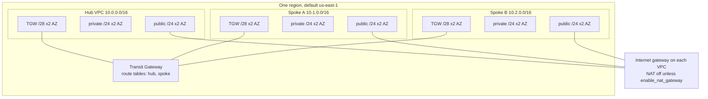
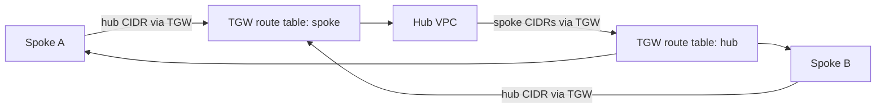

# aws-netops-lab

[](https://github.com/mcoco35/aws-netops-lab/actions/workflows/terraform.yml)

Multi-VPC network lab for one AWS region. Phase 1 builds a hub VPC and two spoke VPCs, connects them with a Transit Gateway, and stops there: no NAT gateways and no EC2 instances unless you opt in. Later phases are planned and are not in this repository yet.

This is a public portfolio project by Mason Coco, a cyber range engineer, for AWS ADC / Amazon Dedicated Cloud network and systems development engineer roles. It is a standalone lab. It does not describe any employer network.

## Architecture



Default forwarding, with `allow_spoke_to_spoke` left false:



Spoke A is not routed to spoke B. The hub can reach both spokes, and each spoke can reach the hub. Workload route tables (public and private) carry those CIDRs. The subnets that hold the Transit Gateway attachment do not route back to the gateway. The full CIDR table and the reason for this policy are in [docs/design-decisions.md](docs/design-decisions.md).

Every resource is tagged `Project=aws-netops-lab` and `ManagedBy=terraform` through provider `default_tags`, plus `Environment` (default `lab`).

## Roadmap

| Phase | Name | Status | Scope |
| --- | --- | --- | --- |
| 1 | Foundation | Built | This repo: VPC and Transit Gateway modules, hub and two spokes, Makefile, CI |
| 2 | Linux routing | Planned | Amazon Linux EC2 routers running FRR with BGP |
| 3 | Netops CLI | Planned | Python boto3 CLI: `netops verify`, `netops chaos`, `netops drill`, and generated postmortems |
| 4 | Observability | Planned | CloudWatch dashboards and alarms |
| 5 | Packaging and docs | Planned | Package the CLI and write the operator docs around the finished lab |

Nothing in phases 2–5 is implemented. Phase 1 does not claim those features.

## Layout

```text
envs/lab/            Root module. Region, CIDRs, routing policy, inter-VPC routes.
envs/lab/tests/      Mocked plan test for the CIDR table. No AWS account.
modules/vpc/         Reusable VPC: public, private, and TGW subnets.
modules/tgw/         Reusable Transit Gateway, attachments, and route tables.
scripts/up.sh        Apply, with a cost banner. Extra args are passed to terraform apply.
scripts/destroy.sh   Destroy this state file. Prompts unless --yes.
docs/                Design notes, including the CIDR plan.
.github/workflows/   fmt, validate, tflint, checkov. No AWS credentials.
```

`envs/lab` is the only root module. `make up` and `make destroy` run there and nowhere else.

## Prerequisites

- Terraform >= 1.10 and < 2. CI uses 1.17.1. 1.10 is the floor because the optional S3 backend example uses `use_lockfile`.
- AWS credentials with permission to create and delete VPCs, subnets, route tables, internet gateways, NAT gateways, and Transit Gateways in the target region. The default stack creates no IAM roles.
- An account you can afford to experiment in. Apply this in a sandbox, not a shared production account.

`make validate` does not need credentials. `make plan`, `make up`, and `make destroy` do.

## Quickstart

```bash
git clone https://github.com/mcoco35/aws-netops-lab.git
cd aws-netops-lab
make validate
make up
```

`make up` runs `terraform init` and `terraform apply -auto-approve` in `envs/lab`. Defaults:

- Region `us-east-1` (`aws_region`)
- Hub `10.0.0.0/16`, spoke A `10.1.0.0/16`, spoke B `10.2.0.0/16`
- Availability zones `us-east-1a` and `us-east-1b` (change `availability_zones` when you change region)
- NAT disabled
- Spoke-to-spoke disabled

Override them by copying the example file and editing it. `terraform.tfvars` is gitignored.

```bash
cp envs/lab/terraform.tfvars.example envs/lab/terraform.tfvars
make plan
```

The region comes from `aws_region`, not from `AWS_REGION`. Set the variable if you do not want `us-east-1`, and set `availability_zones` to zone names in that region. The zone list is pinned so a new availability zone cannot renumber the subnets.

Useful targets:

| Target | What it does |
| --- | --- |
| `make up` | Apply `envs/lab` |
| `make plan` | Plan `envs/lab` |
| `make destroy` | Destroy `envs/lab` without a prompt |
| `make fmt` | `terraform fmt -recursive` |
| `make validate` | `terraform init -backend=false -lockfile=readonly` and `terraform validate` |
| `make test` | Mocked `terraform test` for the CIDR plan. No AWS account. |
| `make lint` | Format check, validate, test, tflint, and checkov |

`./scripts/destroy.sh` prompts until you type `destroy`. `make destroy` passes `--yes`. Both are limited to the `envs/lab` state file.

## Cost and teardown

Confirm current rates on the [Transit Gateway pricing page](https://aws.amazon.com/transit-gateway/pricing/) and the [VPC pricing page](https://aws.amazon.com/vpc/pricing/) before you apply. The figures below are those pages' published example rates, not a measured bill.

| Item | Published example rate | Default lab |
| --- | --- | --- |
| Transit Gateway VPC attachment | $0.05 per attachment-hour, partial hours billed as a full hour. Data processing $0.02/GB in the same example. | 3 attachments. At $0.05, a 730-hour month is 3 × 0.05 × 730 = $109.50 before any bytes. |
| NAT Gateway | $0.045 per gateway-hour and $0.045/GB in the VPC pricing example, plus a public IPv4 address at $0.005/hour. | Not created. |
| VPC, subnets, route tables, internet gateway | No hourly charge. | Created. |

There is no separate hourly charge described for the Transit Gateway object itself in that pricing example. The attachment is what costs money, and it costs money with zero instances behind it.

`make destroy` removes the attachments, the gateway, the VPCs, and the routes in this state. That is the idle state, and it should cost about $0. Leaving the stack applied is not idle.

Set an [AWS Budget](https://docs.aws.amazon.com/cost-management/latest/userguide/budgets-create.html) before the first apply. A monthly cost budget with email alerts at 50% and at 100% of a ceiling you pick (a $25 or $50 ceiling is enough to catch a lab left running) is the right alarm. This repo does not create the budget: the notification address is yours, and the budget should outlive `make destroy`.

## Remote state

State stays on disk at `envs/lab/terraform.tfstate`, which git ignores. `.terraform.lock.hcl` is committed so provider versions do not float.

To use S3, uncomment the backend in `envs/lab/backend.tf`, point it at a bucket you created with encryption and versioning, and run `terraform init -migrate-state`. The example uses `use_lockfile` rather than a DynamoDB table. Keep the bucket name out of git if the bucket is private to you; the committed file ships with `REPLACE_ME`.

## CI

GitHub Actions runs on push and on pull request, with `contents: read` and no AWS credentials:

1. `terraform fmt -recursive -check`
2. `terraform init -backend=false -lockfile=readonly` and `terraform validate` in `envs/lab`
3. `terraform test`, a mocked plan that checks the CIDR table and rejects overlapping VPC CIDRs
4. tflint v0.66.0 with the AWS ruleset
5. checkov 3.4.3

Provider plugins are locked for linux, darwin, and windows so init does not rewrite the lock file on those platforms.

## License

[MIT](LICENSE). Copyright (c) 2026 Mason Coco.
